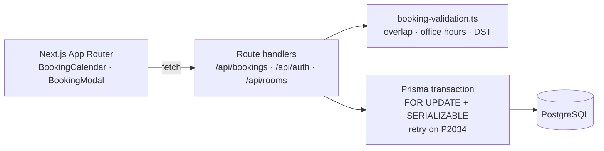

# Meeting Room Booking

> Office meeting-room booking app built for the **UA-Skills Hackathon**. The focus is correctness under concurrency: two people clicking "Book" on the same slot at the same moment never get a double booking.


📖 Full technical write-up (Ukrainian): [`docs/ARCHITECTURE.uk.md`](docs/ARCHITECTURE.uk.md)

---

## Highlights

| Problem | Solution |
|---|---|
| **Race condition** — two concurrent requests both see the slot as free | Row lock on the room (`SELECT … FOR UPDATE`) inside a Prisma transaction **plus** `SERIALIZABLE` isolation; serialization failures (`P2034`) are retried up to 3× with jittered backoff |
| **Overlap detection** | Half-open intervals `[start, end)`: conflict iff `startA < endB && startB < endA`, so back-to-back bookings (10–11, 11–12) are allowed. Coarse SQL filter on a `[roomId, startTime, endTime]` index, exact check in code |
| **Time zones & DST** | All timestamps stored in UTC; office hours (09:00–19:00) validated in `Europe/Kyiv`. Weekly repeats are computed on the Kyiv clock (`addWeeksInKyiv`), so a "Tuesday 10:00" series stays at 10:00 across the DST switch — covered by a regression test on 2026‑10‑25 |
| **Recurring bookings** | All occurrences of a series are validated and created in **one** transaction — any conflict rolls back the whole series. Cancel one occurrence or all future ones |
| **Auth** | JWT session in an `httpOnly` cookie, bcrypt password hashes, email verification with one-time tokens (24h TTL). Booking re-checks `isVerified` from the DB, not from the JWT |

Also: capacity filter, "your booking ends soon and the next slot is taken" notification, mobile-friendly schedule grid.

## Architecture



Data model: `User` · `VerificationToken` · `Room` · `Booking` (`seriesId` groups recurring bookings).

## Quick start

```bash
docker-compose up --build
```

Open **http://localhost:3000**. On start the container waits for PostgreSQL, pushes the schema and seeds demo data (6 rooms, demo bookings for the current week).

| Email | Password |
|---|---|
| `admin@ua-skills.dev` | `password123` |
| `user@ua-skills.dev` | `password123` |

New users registered via `/register` need email verification — the link is printed in the `app` container logs (dev mode, no SMTP).

<details>
<summary>Run without Docker</summary>

Requires Node.js 20+ and PostgreSQL.

```bash
npm install
cp .env.example .env          # set DATABASE_URL and JWT_SECRET
npx prisma migrate dev --name init
npx prisma db seed
npm run dev
```
</details>

## Tests

```bash
npm run test               # unit tests (Vitest) — overlaps, edge cases, DST
npm run test:integration   # Supertest against a real Next.js dev server on :3100
```

- **Unit** — back-to-back vs. partial vs. full overlap, adjacent days, weekly repeats across DST.
- **Integration** — real HTTP requests: successful create (verified in the DB), cancel + repeated cancel → `404`, rejections for past time, outside office hours, overlap and missing auth (`401`). Tests create an isolated room and user and clean up after themselves.

## API

| Method | Endpoint | Description |
|---|---|---|
| `POST` | `/api/auth/register` · `/login` · `/logout` | Session management |
| `GET` | `/api/auth/verify?token=…` | Confirm email |
| `GET` | `/api/rooms` | List rooms |
| `GET` | `/api/bookings` (`?mine=true`) | Bookings for the week / current user |
| `POST` | `/api/bookings` | Create a booking or a weekly series |
| `DELETE` | `/api/bookings/:id` | Cancel one booking |
| `DELETE` | `/api/bookings/series/:seriesId` | Cancel all future occurrences |
